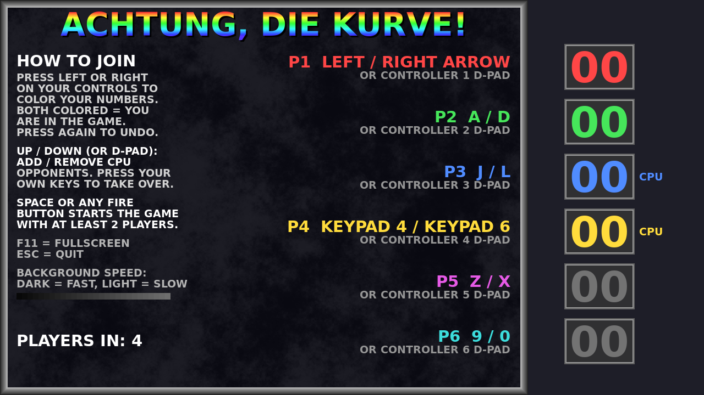
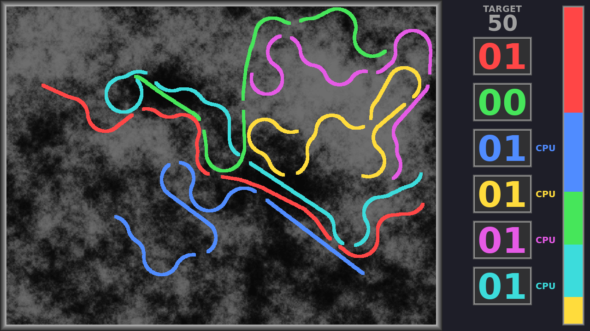

Achtung, die Kurve!
=============

A competitive lightcycles game with smooth curves for up to 6 players controlled by humans or CPU opponents, inspired by the Amiga PD classic with the same name.





How to build
---------------

Needs CMake, SDL2 and SDL2_ttf (the Linux, Switch and Android builds below fetch what they need in Docker). The game is a single source file, `achtung.cpp`. All builds go into a folder next to the project, so the project folder stays clean: run the commands from the folder that contains the `AchtungDieKurve` folder (if yours is named differently, use that name instead, and add `-e PROJECT_DIR=<name>` to the `docker run` commands).

- MacOS:
```
brew install sdl2 sdl3 sdl2_ttf cmake
cmake -S AchtungDieKurve -B build && cmake --build build -j
open build/AchtungDieKurve.app
```
To make a `.dmg` for sharing, run `AchtungDieKurve/make_dmg.sh`. It builds into `build-macos/` and puts the SDL libraries into the app, so it runs on Macs without Homebrew. The result is `build-macos/AchtungDieKurve-<version>-macOS-<arch>.dmg`. The app is signed ad hoc, so the first time it has to be opened with right-click > Open.

- Linux (build for this machine):
```
sudo apt install libsdl2-dev libsdl2-ttf-dev cmake g++
cmake -S AchtungDieKurve -B build && cmake --build build -j
./build/achtung
```

- Linux x64 and Linux arm64 (portable builds, made in Docker):
```
docker build --platform linux/amd64 -t achtung-linux-x64 AchtungDieKurve/linux
docker run --rm --platform linux/amd64 -v "$PWD":/work achtung-linux-x64

docker build --platform linux/arm64 -t achtung-linux-arm64 AchtungDieKurve/linux
docker run --rm --platform linux/arm64 -v "$PWD":/work achtung-linux-arm64
```
Each pair builds the Docker image once (Ubuntu 22.04 with a compiler and the SDL2 / SDL2_ttf development packages) and then creates `build-linux-x86_64/AchtungDieKurve-<version>-linux-x86_64.tar.gz` or `build-linux-aarch64/AchtungDieKurve-<version>-linux-aarch64.tar.gz`. SDL2 and SDL2_ttf are linked dynamically: on the target machine install them once (`sudo apt install libsdl2-2.0-0 libsdl2-ttf-2.0-0`, or your distribution's equivalent), then unpack the archive and run `./achtung`. Keep `font.ttf` next to the executable. The archive also contains a copy of `libSDL2_ttf-2.0.so.0`: if only SDL2 is installed on the target machine (no SDL2_ttf package), start the game with `./runme.sh` instead of `./achtung`. To do the same by hand in the unpacked folder, copy the library from a machine that has it and create the script:
```
cp /lib/x86_64-linux-gnu/libSDL2_ttf-2.0.so.0 .      # aarch64-linux-gnu on arm64
echo -e >runme.sh '#!/usr/bin/env bash\nLD_LIBRARY_PATH=./ ./achtung'
chmod +x runme.sh achtung
```
A build for the other CPU type runs emulated and is slow; the one that matches your machine is fast.

- Switch:
```
docker run --rm --platform linux/amd64 -v "$PWD":/src -w /src devkitpro/devkita64 \
  sh -c 'cmake -S ./AchtungDieKurve -B build-switch -DPLATFORM=SWITCH -DCMAKE_TOOLCHAIN_FILE=$DEVKITPRO/cmake/Switch.cmake && cmake --build build-switch -j'
```
This creates `build-switch/achtung.nro`; copy it to `/switch/` on the SD card. The font is bundled in the .nro.

- Android (handhelds like the Ayaneo Pocket Air Mini, and phones or TVs with a controller):
```
docker build --platform linux/amd64 -t achtung-android AchtungDieKurve/android
docker run --rm --platform linux/amd64 -v "$PWD":/work achtung-android
```
The first command builds the Docker image once, with the Android SDK and NDK, Gradle and the SDL sources (about 5 GB). The second builds `build-android/AchtungDieKurve-<version>.apk`. Install it with `adb install -r`, or copy it to the device and open it there.
  - The build tools only exist for x86-64, so on Apple Silicon Docker emulates them and the first build takes a while. Turning on "Use Rosetta for x86_64/amd64 emulation" in Docker Desktop's settings makes it much faster.
  - `build-android/achtung.keystore` signs the APK. Keep it: with the same key, new versions install over old ones.
  - The game needs a controller (built in or connected); there are no touch controls. The Back button, or Select on the controller, leaves the current game and returns to the title screen.

- Windows:
Install MSYS2 MinGW, then open a msys2 ucrt shell
```
pacman -S mingw-w64-ucrt-x86_64-gcc mingw-w64-ucrt-x86_64-cmake mingw-w64-ucrt-x86_64-ninja mingw-w64-ucrt-x86_64-SDL2 mingw-w64-ucrt-x86_64-SDL2_ttf
cmake -S AchtungDieKurve -B build -G Ninja && cmake --build build -j
curl https://raw.githubusercontent.com/rollerozxa/msys2-bundledlls/master/bundledlls > ./bundledlls
cd build && ../bundledlls ./achtung.exe ./
```
The font (`font.ttf`) is copied next to `achtung.exe` by the build.

The version number is set once, in `CMakeLists.txt` (`project(AchtungDieKurve VERSION ...)`); all platforms and the `.dmg`/`.apk`/`.tar.gz` names take it from there. The app icons are in `icon/` (`icon_switch.jpg` for the Switch, `Achtung.icns` for macOS, `android/` for Android, `icon.png` as the original).

assisted by Claude
